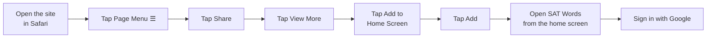
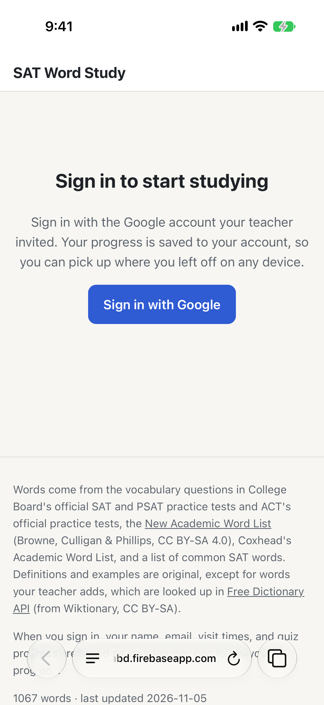
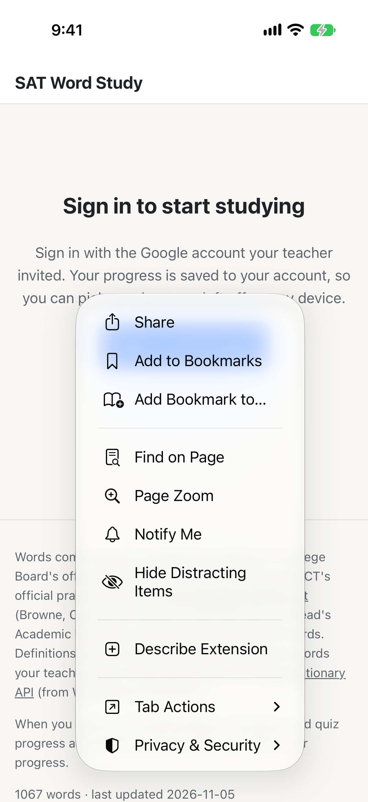
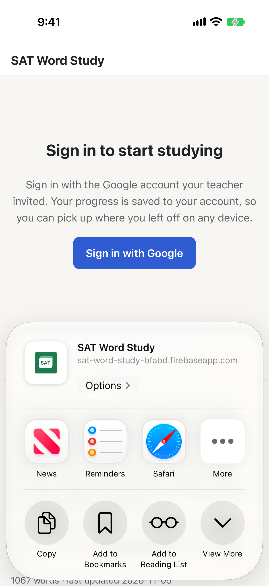
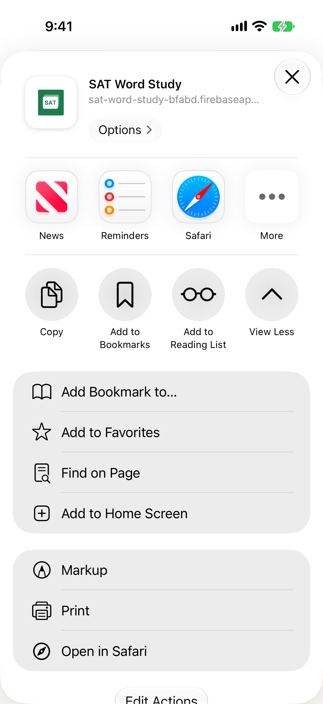
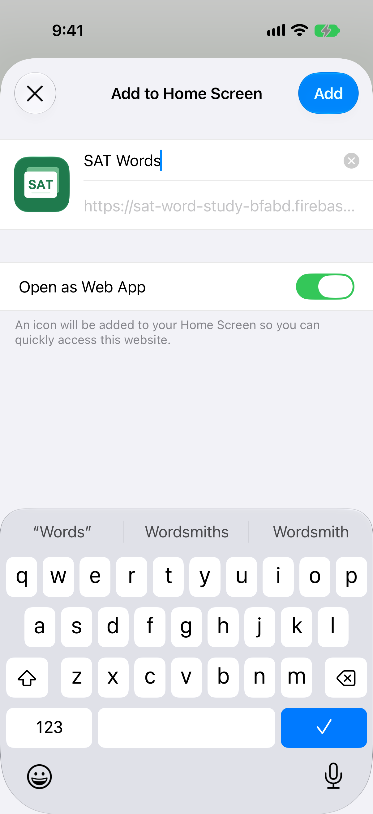
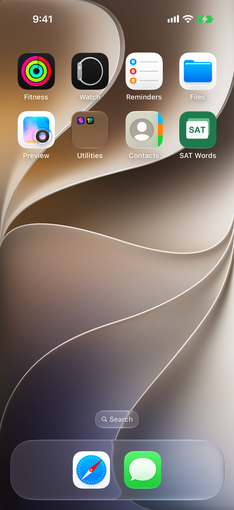
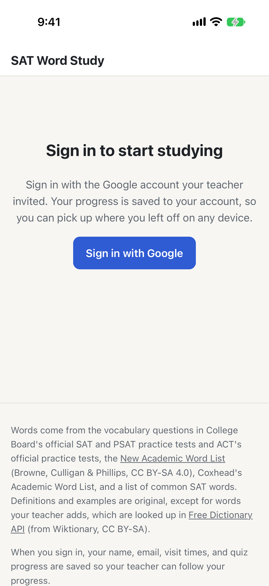
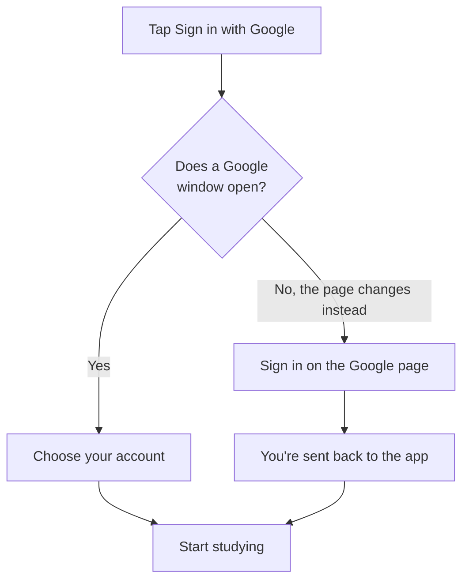

# Installing the SAT Words App

SAT Word Study can sit on your iPhone's home screen like any other app. It opens
full-screen with its own icon, and you don't need the App Store or a download.
It takes about a minute.

A printable version with the same screenshots is at
[sat-word-study-bfabd.firebaseapp.com/install.pdf](https://sat-word-study-bfabd.firebaseapp.com/install.pdf)
(built by `scripts/install-guide/build_pdf.py`).

**You'll need:**
- An iPhone or iPad with Safari
- The Google account your teacher invited

## The steps at a glance



The screenshots below are from Safari on iPhone. The orange outline marks what to tap.

---

## Step 1: Open the site in Safari

Open **Safari** and go to:

```
sat-word-study-bfabd.firebaseapp.com
```

Then tap the **Page Menu** button (☰) at the left of the address bar.

> You don't need to sign in yet. You'll sign in inside the app in step 7.



## Step 2: Tap Share

In the menu that opens, tap **Share**.

> On some iPhones, a Share button (a square with an arrow ⬆) is right in the
> bottom bar. If you see one, tap it and go on to step 3.



## Step 3: Tap View More

The share sheet slides up. Tap **View More** to see the full list of actions.



## Step 4: Tap Add to Home Screen

Tap **Add to Home Screen**.

> **Not in the list?** Scroll to the bottom, tap **Edit Actions…**, and add it.



## Step 5: Tap Add

You'll see the app's icon and its name, **SAT Words**. Leave **Open as Web App**
turned on, then tap **Add** at the top right.



## Step 6: Open SAT Words

The **SAT Words** icon is now on your home screen. Tap it to open the app.



## Step 7: Sign in

The app opens full-screen, without Safari's address bar. Tap
**Sign in with Google** and choose the account your teacher invited.

> The home-screen app keeps its own sign-in, separate from Safari. Even if you
> already signed in on the website, you'll sign in once more here. After that,
> it remembers you.





---

## Troubleshooting

| What you see | What to do |
|---|---|
| **Add to Home Screen** isn't in the list | Make sure you're in Safari. Scroll to the bottom of the list, tap **Edit Actions…**, and add it. |
| It won't let you in after you sign in | Check that you picked the Google account your teacher invited. If it still doesn't work, ask your teacher to check your invite. |
| Sign-in goes back to the sign-in screen | Close the app completely (swipe it away), reopen it, and try again. If it keeps happening, tell your teacher. |
| The address bar still shows | You opened the site in Safari, not the app. Close Safari and tap **SAT Words** on your home screen. |
| The app looks out of date | Close it completely and reopen it. It checks for the newest version every time it opens. |

## Removing the app

Press and hold the **SAT Words** icon, tap **Remove App**, then tap
**Delete from Home Screen**. Your progress is saved to your account, so it will
still be there if you add the app again.

## Android phones

Open the same address in **Chrome**, tap the **⋮** menu at the top right, and
tap **Add to Home screen** (or **Install app**). Then open **SAT Words** from
your home screen and sign in.
